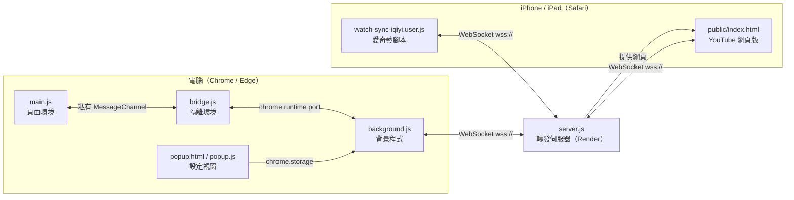

# 專案結構與功能說明

這份文件說明 watch-sync 由哪些部分組成、每個檔案負責什麼、彼此之間怎麼溝通。安裝與使用方式請看 [README](../README.md)。

---

## 1. 整體架構



- 伺服器**只轉發訊息**，依「房間代碼」把訊息送給同房間的其他人，不經手影片內容。
- 每個人播放的都是自己帳號、從平台載入的影片。程式只同步「播放 / 暫停 / 秒數 / 哪一部影片」。

---

## 2. 目錄結構

```
watch-sync/
├─ README.md                     安裝、使用、安全性、更新紀錄
├─ .gitignore                    排除 node_modules
├─ docs/
│  ├─ ARCHITECTURE.md            本文件
│  └─ rejoin-fix-plan.md         換頁重連修正的設計與測試步驟
├─ extension/                    電腦版擴充功能（Chrome / Edge）
│  ├─ manifest.json              擴充功能設定（權限、注入的網站、固定 ID）
│  ├─ main.js                    頁面環境：抓影片、同步播放、自動跳轉
│  ├─ bridge.js                  隔離環境：main.js ↔ background.js 傳話
│  ├─ background.js              背景程式：WebSocket 連線、訊息驗證
│  ├─ popup.html                 設定視窗畫面
│  └─ popup.js                   設定視窗邏輯
├─ ios/
│  └─ watch-sync-iqiyi.user.js   iPhone / iPad 看愛奇藝用的 Userscripts 腳本
└─ server/                       伺服器（部署在 Render）
   ├─ server.js                  WebSocket 轉發伺服器 + 網頁
   ├─ public/index.html          iPhone / iPad 看 YouTube 用的網頁
   ├─ sim.js                     換頁重連緩衝的自動測試
   ├─ package.json               相依套件（ws）與啟動指令
   └─ package-lock.json          固定相依套件版本
```

---

## 3. 功能與對應檔案

| 功能 | 說明 | 電腦擴充功能 | iPhone 愛奇藝 | iPhone YouTube | 伺服器 |
|---|---|---|---|---|---|
| 加入房間 | 用伺服器網址 + 房間代碼連線 | `background.js` | 腳本 `connect()` | `index.html` `connect()` | `server.js` join 處理 |
| 同步播放 / 暫停 / 拖進度 | 自己操作 → 傳給別人；收到 → 套用到播放器 | `main.js` `bind()` `send()` `handle()` | 腳本 `bind()` `send()` `handle()` | `index.html` `onStateChange` `handle()` | 轉發 `play` / `pause` |
| 推送目前進度 | 手動把自己的秒數推給大家 | `main.js` Alt+S | 腳本「↻」按鈕 | 「推送我的進度給對方」按鈕 | 轉發 |
| 自動跳到同一部影片 | 有人選了新影片，其他人自動跟過去 | `main.js` `sendNav()` `goTo()` | 腳本 `sendNav()` `goTo()` | `index.html` `sendNav()` | 轉發 `nav` |
| 新朋友加入時帶他過來 | 房裡的人把目前影片推給新加入的人 | `main.js` peers 處理 | 腳本 peers 處理 | `index.html` peers 處理 | 廣播 `peers` |
| 自動對齊進度 | 新加入、重新整理、跟著跳過來時，向朋友要目前秒數 | `main.js` `askProgress()` | 腳本 `request` | — | 轉發 `request` |
| 換頁重連不被拉回 | 同一個人短時間內重連，不當成新加入 | `main.js` rejoin 分支 | 腳本 rejoin 分支 | — | `server.js` `away` 緩衝 |
| 剛載入時不亂送事件 | 播放器自己跳回上次位置、自動播放，不會被當成操作 | `main.js` `hold` | — | — | — |
| 人數顯示 | 左上角顯示「房內 N 人」 | `main.js` `setBadge()` | 腳本 `setBadge()` | 狀態文字 | `peerCount()` |
| 開關 | 暫時停用同步，設定保留 | `popup.js`、`background.js` | — | — | — |
| iOS 自動播放被擋 | 點一下頁面後補播放並要進度 | — | 腳本 `flush()` | 第一次手動按播放 | — |

---

## 4. 各檔案說明

### 4.1 `extension/manifest.json`

| 設定 | 內容 | 用途 |
|---|---|---|
| `key` | 公鑰 | 固定擴充功能 ID 為 `lkfcgbmfbfadebnadmochcppblfhoijm`，不管放在哪個資料夾都一樣 |
| `permissions` | 只有 `storage` | 儲存伺服器網址、房間代碼、開關、瀏覽器 id |
| `content_scripts` | `bridge.js`（隔離環境）、`main.js`（頁面環境 `MAIN`） | 注入 YouTube、Netflix、愛奇藝（iqiyi.com、iq.com），包含 iframe，在頁面一開始（`document_start`）執行 |
| `background` | `background.js` | 背景程式，負責 WebSocket |
| `minimum_chrome_version` | 111 | `world: "MAIN"` 需要 Chrome 111 以上 |

### 4.2 `extension/main.js`（頁面環境）

在網頁本身的環境執行，因為 Netflix 的播放器 API 只有在這裡才能呼叫。

| 區塊 / 函式 | 功能 |
|---|---|
| 網站判斷 `site`、`videoPage()`、`key()` | 判斷目前是哪個網站、是不是影片頁；`key()` 產生「同一部影片」的比對值（YouTube 看 `v`，其他看路徑） |
| 私有通道 `MessageChannel`、`handOff()` | 和 `bridge.js` 建立私有通道，網頁上的其他腳本無法偷聽或偽造 |
| `setBadge()` | 左上角狀態標籤 |
| `nf()`、`seek()`、`play()`、`pause()` | 控制播放器；Netflix 走它自己的 player API，其他直接操作 `<video>` |
| `bind()`、`send()` | 監聽 `play` / `pause` / `seeked`，把自己的操作送出去 |
| `handle()` | 套用別人的操作（跳秒數、播放 / 暫停），期間 1.2 秒不送出自己的事件，避免互相觸發 |
| `hold`、`release()`、`holdFor()` | 頁面剛載入時先不送出事件，等對完朋友的進度（最多 3 秒）或確認房裡只有自己後才恢復；最久 8 秒 |
| `cleanUrl()`、`okVideoUrl()` | 影片網址只留必要部分；只允許跳到 https 的真正影片頁 |
| `sendNav()`、`goTo()` | 推送目前影片；收到別人的影片後跳過去，並留下「跟隨而來」的記號 |
| `askProgress()` | 向朋友要目前進度，還沒找到 `<video>` 就等找到再送 |
| peers 處理 | 決定要推影片、要進度、還是什麼都不做（見第 6 節） |
| Alt+S | 手動推送自己的進度 |
| 每秒輪詢 | 連線、偵測換影片（YouTube / Netflix 是單頁應用）、找 `<video>`、記錄目前影片到 sessionStorage |

### 4.3 `extension/bridge.js`（隔離環境）

只負責傳話：

- 收下 `main.js` 交過來的私有通道（只接受第一條）。
- `main.js` 要求連線時，開一條到背景程式的 `chrome.runtime` 連線。
- 雙向轉送訊息；背景程式中斷時通知頁面「請重新整理」。

### 4.4 `extension/background.js`（背景程式）

| 區塊 / 函式 | 功能 |
|---|---|
| `connect()` | 讀設定、建立 WebSocket、送出 `join`；斷線 3 秒後重連 |
| 被拒絕的處理 | 代碼 `1008`（房間代碼太短、加入太頻繁、來源不符）不重連；`1013`（房間已滿、連線太多）30 秒後再試 |
| `cleanOut()` | 送出前驗證：只放行已知類型與合理的欄位 |
| `cleanIn()` | 收到後驗證：伺服器的訊息也不盡信 |
| `serverOk()` | 只允許 `wss://`；`ws://` 只限 localhost |
| `uid` | 每個瀏覽器一個固定 id，加上分頁 id 成為 peer id |
| 設定變更、開關 | 設定改了就重連；關閉時工具列顯示紅色 OFF |

WebSocket 放在背景程式，是因為 YouTube / Netflix 的 CSP 會擋掉頁面裡的連線。

### 4.5 `extension/popup.html`、`popup.js`

設定視窗：同步開關（立即生效）、伺服器網址、房間代碼；房間代碼少於 8 個字元時提醒。

### 4.6 `ios/watch-sync-iqiyi.user.js`

iPhone / iPad 的 Safari + Userscripts 腳本，只支援愛奇藝，直接在頁面裡連 WebSocket。

| 區塊 / 函式 | 功能 |
|---|---|
| `getVal()`、`setVal()`、`loadCfg()` | 設定存在腳本自己的空間（`GM.getValue` / `GM.setValue`）；不支援時退回 localStorage；舊設定自動搬移 |
| `askCfg()` | 跳出輸入框設定伺服器網址、房間代碼 |
| `makeBar()`、`setBadge()` | 左上角狀態文字（點擊可改設定）與「↻」推送按鈕 |
| `connect()` | 連線、處理伺服器訊息、斷線重連 |
| `handle()`、`flush()` | 套用別人的操作；被 iOS 擋自動播放時，點一下頁面再補播放 |
| `sendNav()`、`goTo()` | 推送 / 跟隨影片；同一網址 30 秒內只自動跳一次（防迴圈） |

### 4.7 `server/server.js`

| 區塊 / 函式 | 功能 |
|---|---|
| HTTP | `/`、`/index.html` 回傳 YouTube 網頁版；`/healthz` 健康檢查；其他 404；加上安全標頭 |
| `originAllowed()`、`matchOrigin()` | 來源白名單（`ALLOWED_ORIGINS`） |
| `clientIp()` | 取得真實 IP（`PROXY_HOPS`） |
| `ipConns` | 每個 IP 同時連線數上限（`MAX_PER_IP`） |
| `joinAllowed()` | 每個 IP 加入次數上限（`JOIN_LIMIT` / `JOIN_WINDOW_MIN`） |
| join 處理 | 驗證房間代碼長度、房間人數；每條連線只能加入一次，失敗即斷線 |
| `away`、`peerCount()` | 換頁重連緩衝（`REJOIN_GRACE_SEC`）；人數 = 在線 + 緩衝中的人 |
| `broadcastPeers()` | 通知房內人數，標出誰是剛加入的人 |
| 訊息轉發 | 只轉發 `play` / `pause` / `nav` / `request`，欄位重新組過再送 |
| 速率限制 | 單則 4KB、每 10 秒 60 則 |
| 心跳 / 清理 | 每 20 秒送心跳（避免休眠）；每 30 秒清掉沒回應的連線 |

### 4.8 `server/public/index.html`

iPhone / iPad 看 YouTube 用的網頁，由伺服器提供，用 YouTube 內嵌播放器（IFrame API）。輸入房間代碼與 YouTube 網址即可同步；換影片時推給其他人。

### 4.9 `server/sim.js`

換頁重連緩衝的自動測試（S1–S6）：

```bash
REJOIN_GRACE_SEC=2 PORT=8099 node server.js
```

```bash
PORT=8099 node sim.js
```

---

## 5. 訊息格式

所有訊息都是 JSON，透過 WebSocket 傳送。

### 客戶端 → 伺服器

| 類型 | 欄位 | 說明 |
|---|---|---|
| `join` | `room`、`peer` | 加入房間；`peer` 是瀏覽器 id + 分頁 id |
| `play` / `pause` | `time`（秒） | 我播放 / 暫停了，目前在第幾秒 |
| `nav` | `url` | 我在看這部影片 |
| `request` | — | 請把你們目前的進度告訴我 |

### 伺服器 → 客戶端

| 類型 | 欄位 | 說明 |
|---|---|---|
| `peers` | `count`、`me`、`rejoin` | 房內人數；`me` = 這則是因為你加入；`rejoin` = 你是換頁重連，不是新加入 |
| `status` | `text`、`ok` | 狀態訊息（例如房間代碼太短、加入太頻繁） |
| `play` / `pause` / `nav` / `request` | 同上 | 別人送來的訊息（伺服器驗證過才轉發） |
| `hb` | — | 心跳 |

### 關閉代碼

| 代碼 | 原因 | 客戶端行為 |
|---|---|---|
| `1008` | 房間代碼太短、加入太頻繁、來源不符、訊息太頻繁、10 秒內沒加入 | 不自動重連 |
| `1013` | 房間已滿、同一 IP 連線太多、伺服器滿載 | 30 秒後再試 |
| 其他 | 網路中斷等 | 3 秒後重連 |

---

## 6. 主要流程

### 6.1 第一次加入房間

1. 開影片頁 → `main.js` 要求連線 → `background.js` 送出 `join`。
2. 伺服器回給我 `peers`（`me: true`），也通知其他人 `peers`（`me: false`）。
3. 其他人看到人數增加 → 把自己的影片 `nav` 推給我 → 我跳過去。
4. 我向大家要進度（`request`）→ 對方回 `play` / `pause` + 秒數 → 我對齊。

### 6.2 換頁 / 重新整理（換頁重連）

1. 舊頁面關閉 → 連線中斷 → 伺服器把我放進緩衝名單，**不通知**其他人。
2. 新頁面在 `REJOIN_GRACE_SEC`（10 秒）內重新加入 → 伺服器只回給我 `peers`（`rejoin: true`）。
3. `main.js` 判斷：

| 情況 | 判斷方式 | 動作 |
|---|---|---|
| 在首頁、搜尋頁 | 不是影片頁 | 什麼都不做（不會被拉回） |
| 跟著朋友跳過來 | sessionStorage 有 `wsyncFollow` 記號 | 要進度 |
| 同一部影片重新整理 | 和上一頁記下的 `wsyncKey` 相同 | 要進度 |
| 自己選了新影片 | 以上皆非 | 推出影片，朋友跟過來 |

4. 超過緩衝時間才回來 → 當作新加入（6.1）。

### 6.3 同步播放

1. 我按播放 / 暫停 / 拖進度 → `<video>` 事件 → `send()` → 經 `bridge.js`、`background.js` 驗證 → 伺服器 → 其他人。
2. 其他人 `handle()`：秒數差超過 0.5 秒才跳，再播放 / 暫停；1.2 秒內不送出自己的事件，避免互相觸發。

---

## 7. 資料存放位置

| 資料 | 位置 | 誰讀得到 |
|---|---|---|
| 電腦：伺服器網址、房間代碼、開關、瀏覽器 id | `chrome.storage.local` | 只有擴充功能 |
| 電腦：目前影片、跟隨記號 | 網站的 sessionStorage（`wsyncKey`、`wsyncFollow`） | 該網站的腳本（只影響推影片 / 要進度的判斷） |
| iPhone：伺服器網址、房間代碼、peer id | 腳本空間（`GM.getValue`）；不支援時用 localStorage | 腳本空間：只有腳本；localStorage：愛奇藝網頁上的腳本 |
| iPhone：跳轉防迴圈、目前影片 | 網站的 sessionStorage（`wsyncGo`、`wsyncKey`） | 愛奇藝網頁上的腳本 |
| 伺服器 | 只存在記憶體，重啟即消失 | — |
| 伺服器日誌 | 只記房間代碼雜湊的前 6 碼，不記代碼與 IP | Render 帳號擁有者 |

---

## 8. 安全機制對應

| 防護 | 位置 |
|---|---|
| 只允許加密連線（`wss://`） | `background.js` `serverOk()`、iOS 腳本 `serverOk()` |
| 私有通道（網頁腳本無法偽造） | `main.js` + `bridge.js` |
| 送出 / 收到都驗證欄位 | `background.js` `cleanOut()` / `cleanIn()`、`server.js` 轉發 |
| 只跳到真正的影片頁 | `main.js` `okVideoUrl()`、iOS 腳本 `okVideoUrl()` |
| 網址只留必要部分 | `main.js` `cleanUrl()`、iOS 腳本 `sendNav()` / `goTo()` |
| 防止猜房間代碼 | `server.js`：每條連線只能加入一次、`joinAllowed()` |
| 防止佔滿連線 | `server.js`：`MAX_PER_IP`、`MAX_CONNECTIONS`、10 秒內沒加入就斷線 |
| 來源白名單 | `server.js` `originAllowed()` |
| 訊息大小與頻率 | `server.js`：4KB、每 10 秒 60 則 |
| 安全標頭 | `server.js` `SEC_HEADERS` |
| iPhone 設定不給網站讀 | iOS 腳本 `getVal()` / `setVal()` |

伺服器的環境變數設定請見 README 的「可選設定」。

---

## 9. 已知限制與待辦

- **Firefox 不支援**：背景程式寫法、連線來源格式、簽署要求都不同。
- **iOS 腳本**：重新整理後，播放器自己的事件可能把朋友拉到你的進度（電腦版已修，iOS 尚未）。
- **愛奇藝 iframe**：第一次加入時，如果播放器所在的 iframe 比主頁面先連上，可能不會被帶到朋友的影片。
- **未實測**：愛奇藝、Netflix、Edge、iPhone 實機。
- **`ALLOWED_ORIGINS`**：大家都換成固定 ID 的新版後，建議只放行 `chrome-extension://lkfcgbmfbfadebnadmochcppblfhoijm`。
